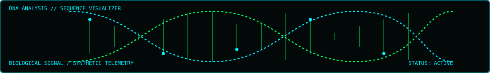
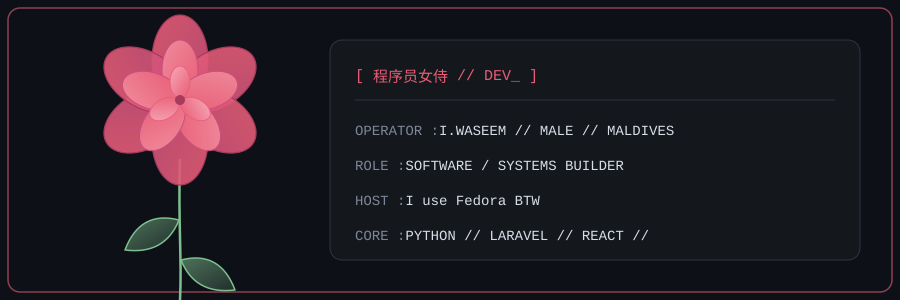

<!-- TOP HTML GIF BANNER & HUD ICONS -->

  <code>Simplicity is prerequisite for reliability. // SYSTEM_READY</code>
    
  
    

  <samp>
    <code style="color:#00ff66">iboo@Fedora:~$ sudo cat /home/iboo/ABOUTME.md
</code>
  </samp>

  

<table align="center" width="100%" style="border-collapse: collapse; background-color: #050508; border: 2px solid #00f0ff; font-family: monospace; color: #00ff66;">

  <!-- COOKIE CACHE SECTION -->
  <tr>
    <td colspan="2" style="border: 1px solid #00f0ff55; padding: 12px; background-color: #080c14;">
      <b>[ 饼干缓存 // COOKIE_cache </b> 
      <pre style="margin: 4px 0; color: #00ff66; font-size: 11px;">
┌───────────────────────────────────────────────────────────────────────────────────────────┐
│  (░░░░░)       (█████)       (▓▓▓▓▓)       (▒▒▒▒▒)   [ 缓存一: 84% ]  COOKIE_BUFFER        │
│ (░ O  ░░)     (█ O  ██)     (▓  O ▓▓)     (▒ O  ▒▒)  [ 缓存二: 100%] SESSION_ID            │
│ (░░  O ░)     (██  O █)     (▓▓  O ▓)     (▒▒  O ▒)  [ 缓存三: 65% ]  USER_PREF            │
│  (░░░░░)       (█████)       (▓▓▓▓▓)       (▒▒▒▒▒)   [ 缓存四: 92% ]  CACHE_DATA           │
└───────────────────────────────────────────────────────────────────────────────────────────┘
      </pre>
    </td>
  </tr>

  <!-- DIVIDER -->
  <tr>
    <td colspan="2" align="center" style="border: 1px solid #00f0ff33; color: #008822; font-size: 12px; padding: 2px;">
      ═════════════════════════════════════════════════════════════════════════════════════════════
    </td>
  </tr>

  <!-- OPERATOR SPEC & TELEMETRY METRICS -->
  <tr>
    <td width="50%" valign="top" style="border: 1px solid #00f0ff55; padding: 12px; background-color: #080c14;">
      <b>[ 操作员信息 // OPERATOR_SPEC ]</b> 
      ──────────────────────────────────────── 
      姓名 / NAME   : <b>Ibrahim Waseem (iboo)</b> 
      位置 / LOC    : Malé, Maldives [UTC+5] 
      环境 / HOST   : <b>I use Fedora BTW</b> 
      语言 / STACK  : Python / C / javascript / PHP / React 
      数据库 / DB   : PostgreSQL / MySQL
    </td>
    <td width="50%" valign="top" style="border: 1px solid #00f0ff55; padding: 12px; background-color: #080c14;">
      <b>[ 运行状态 // TELEMETRY_METRICS ]</b> 
      ──────────────────────────────────────── 
      PYTHON / DJANGO [████████████████████] 100% 
      DOCKER / PODMAN [████████████████░░░░]  85% 
      REACT / .NET API[██████████████░░░░░░]  75% 
      AI / ML     [██████████████████░░]  90% 
      状态 / STATUS   : <b>[ ACTIVE_DEVELOPMENT ]</b>
    </td>
  </tr>

  <!-- ACTIVE PROJECTS & NODE SPEC -->
  <tr>
    <td width="50%" valign="top" style="border: 1px solid #00f0ff55; padding: 12px; background-color: #080c14;">
      <b>[ 核心项目 // ACTIVE_PROJECTS ]</b> 
      ──────────────────────────────────────── 
      <b>░░ HOUSING 4 RAAJJE</b> [房屋管理] 
         └─ API // React // PostgreSQL  
      <b>░░ UNDERWATER DEBRIS</b> [水下检测] 
         └─ YOLOv8 // FUnIE-GAN  
    </td>
    <td width="50%" valign="top" style="border: 1px solid #00f0ff55; padding: 12px; background-color: #080c14;">
      <b>[ 节点信息 // NODE_SPEC ]</b> 
      ──────────────────────────────────────── 
      架构 / ARCH     : CONTAINER_NGINX_NET_PG 
      引擎 / ENGINE   : DOCKER_COMPOSE 
      状态 / STATUS   : <b>DEPLOYED_ACTIVE</b> 
      ──────────────────────────────────────── 
      传输 / STREAM   : HYBRID_STACK 
      信号 / SIGNAL   : 100% // STABLE
    </td>
  </tr>

  <!-- DIVIDER -->
  <tr>
    <td colspan="2" align="center" style="border: 1px solid #00f0ff33; color: #008822; font-size: 12px; padding: 2px;">
      ═════════════════════════════════════════════════════════════════════════════════════════════
    </td>
  </tr>

  <!-- FOOTER -->
  <tr>
    <td colspan="2" align="center" style="padding: 10px; background-color: #050508;">
      [ 系统消息 // SYS_MSG ] :: EOF // TRANSMISSION_COMPLETE // 传输结束
    </td>
  </tr>

</table>

